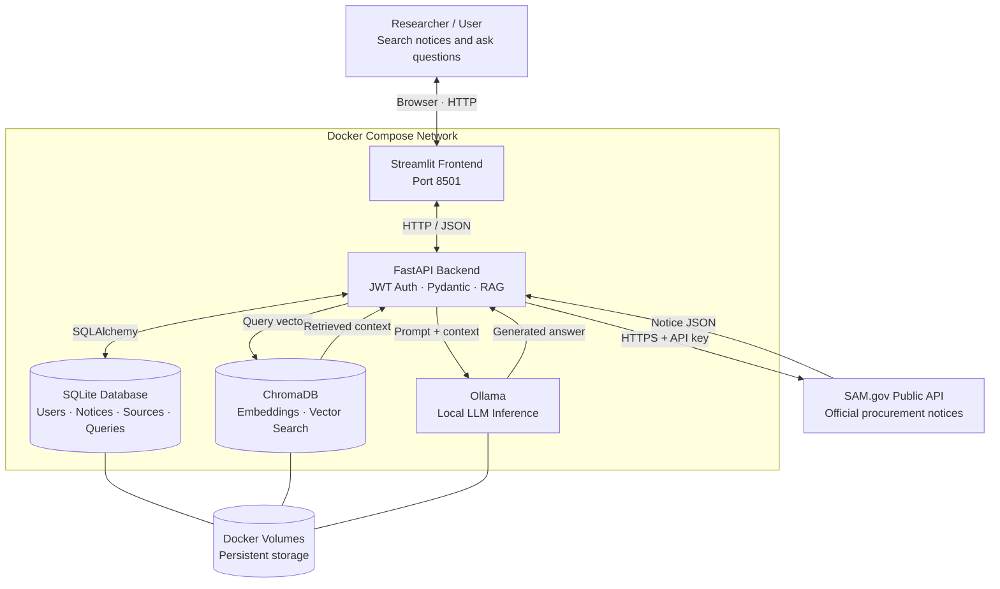
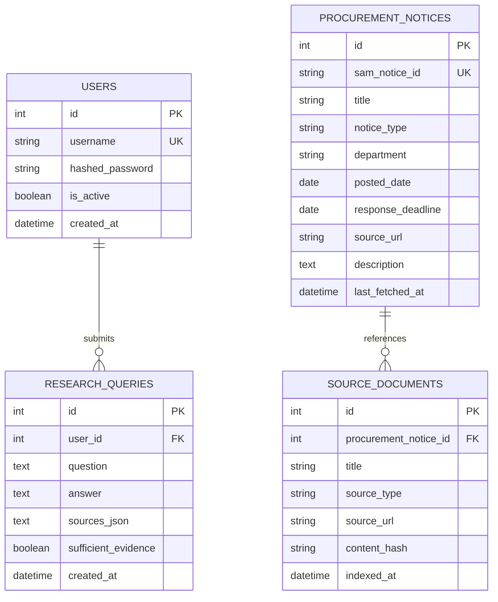

## User Guide
Welcome to Sentinel Scout, your AI-powered federal procurement research assistant. This guide will walk you through setting up your account, searching official government notices, and leveraging retrieval-augmented generation (RAG) with strict citation guardrails to conduct multi-departmental analysis.

1. Getting Started & Authentication

Before running queries, you'll need to authenticate with the system.
Accessing the Interface

    Ensure your Docker containers are running (docker compose up).

    Open your web browser and navigate to the Streamlit Frontend:

        http://localhost:8501

Creating an Account & Logging In

    When you first open the app, use the authentication sidebar to register a new account (/auth/register) with a secure username and password.

    Log in using your credentials. The app will securely store your expiring JWT session token in the background to authenticate your API requests.

2. Synchronizing Procurement Data

Before asking questions, your local database needs to be populated with real procurement notices from SAM.gov.

    Navigate to the Data Synchronization tab in the UI.

    Specify a date range (posted_from and posted_to) and an optional notice type or department filter (e.g., NAVSUP or NAVSEA).

    Click Sync Documents.

        The backend securely uses its server-side SAM.gov API key to fetch notices, upsert structured records into SQLite, and embed searchable text chunks into ChromaDB.

Sentinel Scout includes a pre-packaged, multi-agency dataset covering NAVSUP, NAVSEA, Air Force, Army, and Defense Logistics Agency (DLA) procurement notices. This allows a user or an evaluator to test RAG retrieval and citation generation immediately after launching the application without needing an active SAM.gov API key. Located in seeds dir to populate into the database use. * Must have a API KEY from SAM.gov in order to use the ingestion endpoint in the ui.
- RUN 
    PYTHONPATH=. python seeds/ingest_folder.py

3. Searching & Browsing Stored Notices

You can explore your indexed database without invoking the LLM:

    Go to the Documents tab.

    Use keywords, notice types, or date filters to search locally stored notices instantly.

    Click on any notice to inspect its full description, response deadlines, and official SAM.gov source URL.

4. Asking Research Questions (RAG Pipeline)

This is the core feature of Sentinel Scout. The system retrieves relevant evidence passages, checks them against a sufficiency threshold, and prompts the local LLM to generate an answer—enforcing strict citation links back to official sources.
Example Presentation Queries

To showcase the system's precision and cross-departmental capabilities during your demo, try entering these queries:

    Focused & Direct (Hardware Precision):

        "What specific repair and modification scopes does NAVSUP outline for the manifold assembly and video recorder contracts?"

    Cross-Departmental Synthesis (Multi-Agency Analysis):

        "Compare and contrast the primary electronic and mechanical equipment targeted for repair, modification, and calibration between NAVSUP and NAVSEA procurement notices."

Reviewing Answers & Citations

    Evidence-Backed Output: Every generated answer will feature clear source references and excerpts.

    Backend Guardrails: If the retrieved text does not contain enough evidence to answer your question, the system will transparently report insufficient evidence rather than guessing or hallucinating facts.

### Startup and Initialization

The intended development startup command is:

    docker compose up --build

The first startup may take longer because images and the configured
Ollama model may need to be downloaded.

The implementation must provide a reliable model initialization
procedure and meaningful health checks. A running container alone
does not prove that its service is ready to handle requests.

Service startup dependencies should use health checks where appropriate.
The application must still handle temporary dependency failures.

### Resource and Security Considerations

- Pin tested container image versions rather than relying on `latest`.
- Keep ChromaDB and Ollama ports private unless temporary debugging access
  is required.
- Use persistent volumes for application data and model files.
- Avoid logging credentials or sensitive user research.
- Do not delete persistent data as part of normal container startup.
- Test the full stack on the target machine before finalizing resource
  expectations.

# Sentinel Scout technical overview

Sentinel Scout is an AI-powered procurement research application that retrieves federal acquisition information from SAM.gov and uses retrieval-augmented generation (RAG) to answer questions with traceable evidence from official government documents.

## System Architecture

The diagram below shows the application's services, communication paths, and data storage.

## Database Schema

Sentinel Scout uses SQLAlchemy with SQLite for structured data storage.
The database layer will be kept separate from business logic so that
PostgreSQL can be adopted later without rewriting the application.

### Entity Relationship Diagram

### 1. Users

**Purpose:** Store application user accounts for JWT authentication.

| Field             | Type     | Constraints                  |
| ----------------- | -------- | ---------------------------- |
| `id`              | Integer  | Primary key                  |
| `username`        | String   | Required, unique, indexed    |
| `hashed_password` | String   | Required                     |
| `is_active`       | Boolean  | Required, defaults to `true` |
| `created_at`      | DateTime | Required                     |

**Relationship:** One user can submit many research queries.

**Security:** Passwords are hashed before storage. Plaintext passwords and signing secrets are never stored in this table.

### Data Ownership, Privacy, and Storage Boundaries

#### User Query Isolation

- Every research query belongs to the authenticated user who created it.
- The backend derives the user identity from the verified JWT.
- Clients cannot select or override the owner of a research query.
- Query-history reads must be scoped to the authenticated user's ID.
- Users must not be able to retrieve another user's questions, answers, or source history.
- Automated tests must verify cross-user access is denied.

#### Evidence Reproducibility

When practical, a research result should record enough information to
identify the source versions and retrieved passages used at answer time.
This helps distinguish the original evidence from the model's
interpretation and supports later historical validation.

### 2. Procurement Notices

**Purpose:** Store structured procurement notice data retrieved from the official SAM.gov API.

| Field               | Type     | Constraints               |
| ------------------- | -------- | ------------------------- |
| `id`                | Integer  | Primary key               |
| `sam_notice_id`     | String   | Required, unique, indexed |
| `title`             | String   | Required                  |
| `notice_type`       | String   | Notice classification     |
| `department`        | String   | Agency or department      |
| `posted_date`       | Date     | Nullable if unavailable   |
| `response_deadline` | Date     | Nullable                  |
| `source_url`        | String   | Official notice URL       |
| `description`       | Text     | Notice description        |
| `last_fetched_at`   | DateTime | Nullable                  |

**Design decision:** `sam_notice_id` is the unique external identifier. Repeated synchronization must update an existing notice rather than create duplicates.

### 3. Source Documents

**Purpose:** Track the provenance of documents indexed for retrieval-augmented generation (RAG).

Sources may include SAM.gov notices and official Federal Acquisition Regulation (FAR) reference material.

| Field                   | Type     | Constraints                                  |
| ----------------------- | -------- | -------------------------------------------- |
| `id`                    | Integer  | Primary key                                  |
| `procurement_notice_id` | Integer  | Nullable foreign key                         |
| `title`                 | String   | Required                                     |
| `source_type`           | String   | For example, `sam_notice` or `far_reference` |
| `source_url`            | String   | Source location                              |
| `content_hash`          | String   | Used to detect content changes               |
| `indexed_at`            | DateTime | Nullable                                     |

**Relationship:** One procurement notice can reference multiple source documents. FAR reference documents may exist without a procurement notice, so `procurement_notice_id` is nullable.

**Design decision:** Document metadata is stored in SQLite. ChromaDB stores vector embeddings and searchable chunks. Retrieved chunks should retain stable source identifiers and URLs so answers can be traced back to evidence.

#### Source Content and Metadata

- SQLite stores structured records and source metadata rather than
  duplicating large document bodies unnecessarily.
- Original or normalized source content is retained in persistent
  document storage when required for provenance and reproducibility.
- ChromaDB stores searchable chunks, embeddings, and metadata linking
  each chunk to its source document and version.
- ChromaDB is a retrieval index, not the authoritative evidence archive.
- Source identifiers, URLs, content hashes, and version information
  should be retained where available.
- Research results should preserve references to the evidence used
  to generate each answer.

### 4. Research Queries

**Purpose:** Maintain a history of user questions, generated answers, and their supporting evidence.

| Field                 | Type     | Constraints                             |
| --------------------- | -------- | --------------------------------------- |
| `id`                  | Integer  | Primary key                             |
| `user_id`             | Integer  | Required foreign key to `users.id`      |
| `question`            | Text     | Required                                |
| `answer`              | Text     | Nullable                                |
| `sources_json`        | Text     | Nullable; serialized source references  |
| `sufficient_evidence` | Boolean  | Records evidence-sufficiency assessment |
| `created_at`          | DateTime | Required                                |

**Relationship:** Each research query belongs to one user. A user may have many research queries.

**Design decision:** `sufficient_evidence` records whether the retrieval process met its configured evidence threshold. It does not guarantee that a generated answer is factually correct.

### Relationships Summary

| Parent                | Child              | Relationship | Purpose                              |
| --------------------- | ------------------ | ------------ | ------------------------------------ |
| `users`               | `research_queries` | One-to-many  | Track research activity by user      |
| `procurement_notices` | `source_documents` | One-to-many  | Link notice records to their sources |

### Data Integrity and Sentinel Principles

- Primary keys uniquely identify internal records.
- Foreign keys enforce the defined relationships.
- Unique constraints prevent duplicate usernames and SAM.gov notice IDs.
- Source URLs and identifiers preserve provenance.
- Content hashes help identify changed source material.
- Generated answers remain distinct from source facts.
- ChromaDB records should retain metadata linking retrieved chunks to source documents.
- Timestamps should use a consistent UTC convention where practical.
- Future market relationships, scoring, and learning tables are outside the current capstone scope.

## API Endpoint Design

Sentinel Scout uses FastAPI for its HTTP API and Pydantic for request
validation, response validation, and API schema generation.

Authenticated endpoints use a signed, expiring JWT issued by Scout.
The SAM.gov API key is a separate credential used only by the backend
when communicating with the official SAM.gov API.

### Endpoint Summary

| Method | Endpoint                     | Purpose                                      | Authentication |
| ------ | ---------------------------- | -------------------------------------------- | -------------- |
| POST   | `/auth/register`             | Create a user account                        | Public         |
| POST   | `/auth/token`                | Verify credentials and issue JWT             | Public         |
| GET    | `/documents`                 | Search stored procurement notices            | JWT required   |
| GET    | `/documents/{sam_notice_id}` | Retrieve one notice by SAM.gov ID            | JWT required   |
| POST   | `/documents/sync`            | Synchronize a bounded set of notices         | JWT required   |
| POST   | `/ask`                       | Run RAG and return an evidence-backed answer | JWT required   |
| GET    | `/health`                    | Report service readiness                     | Public         |

### 1. POST /auth/register

Purpose: Create a new Scout user account.

Request schema: `UserRegisterRequest`

- `username`: string, required
- `password`: string, required; enforce a minimum length and password policy

Response schema: `UserResponse`

- `id`
- `username`
- `is_active`
- `created_at`

Authentication: Public.

Validation and errors:

- Reject duplicate usernames.
- Return a validation error for invalid input.
- Never return a password or password hash.

### 2. POST /auth/token

Purpose: Verify credentials and issue a JWT access token.

Request schema: `LoginRequest`

- `username`: string, required
- `password`: string, required

Response schema: `TokenResponse`

- `access_token`
- `token_type`
- `expires_in`

Authentication: Public.

Validation and errors:

- Verify the supplied password against its stored hash.
- Return a generic authentication error for invalid credentials.
- Sign tokens using the configured JWT secret and expiration policy.

### 3. GET /documents

Purpose: Search procurement notices already stored in the local database.

Query parameters: `DocumentSearchParams`

- `keyword`: optional string
- `notice_type`: optional string
- `posted_from`: optional date
- `posted_to`: optional date
- `page`: integer, minimum 1; default 1
- `page_size`: integer, range 1–100; default 20

Response schema: `DocumentListResponse`

- `items`: list of `DocumentResponse`
- `total`: total matching records
- `page`
- `page_size`

Authentication: JWT required.

Validation and errors:

- Reject invalid date ranges.
- Apply pagination limits.
- Search the local database rather than calling SAM.gov on every request.

### 4. GET /documents/{sam_notice_id}

Purpose: Retrieve a single stored procurement notice using its external SAM.gov identifier.

Path parameter:

- `sam_notice_id`: string, required

Response schema: `DocumentResponse`

- `sam_notice_id`
- `title`
- `notice_type`
- `department`
- `posted_date`
- `response_deadline`
- `source_url`
- `description`

Authentication: JWT required.

Errors:

- Return 404 if the notice does not exist locally.

### 5. POST /documents/sync

Purpose: Retrieve a bounded set of notices from the official SAM.gov API, validate them, upsert structured records, and index eligible text.

Request schema: `DocumentSyncRequest`

- `posted_from`: date
- `posted_to`: date
- `notice_type`: optional string
- `limit`: integer with an enforced maximum

Response schema: `DocumentSyncResponse`

- `fetched_count`
- `inserted_count`
- `updated_count`
- `indexed_count`
- `failed_count`

Authentication: JWT required.

Validation and errors:

- Enforce date-window and result-count limits.
- Handle timeouts, upstream errors, and malformed API responses.
- Keep the SAM.gov API key server-side.
- Use the SAM.gov notice ID to prevent duplicate records.
- Report partial failures rather than claiming every record succeeded.

### 6. POST /ask

Purpose: Retrieve relevant source passages and use Ollama to generate an answer grounded in that evidence.

Request schema: `AskRequest`

- `question`: string, minimum 5 characters, maximum 2,000 characters

Response schema: `AskResponse`

- `answer`: string
- `sources`: list of `SourceReference`
- `sufficient_evidence`: boolean

Each `SourceReference` includes:

- `title`
- `source_url`, when available
- `excerpt`
- A stable source identifier or version reference, when available

Authentication: JWT required.

Processing:

1. Validate the question and authenticate the user.
2. Retrieve relevant passages from ChromaDB.
3. Assess whether the retrieved evidence meets the configured threshold.
4. Send the question and supporting context to Ollama.
5. Return the answer with source references.
6. Store the query, answer, evidence references, and sufficiency result.

If evidence is insufficient, the application must communicate that limitation rather than present an unsupported answer as established fact.

Privacy:

- Derive the query's `user_id` from the verified JWT.
- Never accept a client-supplied owner ID.
- Query-history access must be restricted to the authenticated user.

### 7. GET /health

Purpose: Report whether the application and its dependencies are reachable.

Response schema: `HealthResponse`

- `status`: overall status
- `backend`: status
- `database`: status
- `chromadb`: status
- `ollama`: status

Authentication: Public.

Security:

- Do not expose credentials, environment variables, stack traces, or sensitive internal configuration.
- Report dependency failures accurately.

### Shared API Rules

- All endpoints use typed request parameters and appropriate Pydantic schemas.
- Response bodies are validated against their declared response models.
- Use HTTPS when deployed beyond a trusted local development environment.
- Use `401 Unauthorized` for missing or invalid authentication.
- Use `403 Forbidden` when an authenticated user lacks permission.
- Use `404 Not Found` for missing records.
- Use `422 Unprocessable Entity` for invalid request data.
- Use appropriate `502 Bad Gateway` or `503 Service Unavailable` responses for upstream failures.
- Never return passwords, signing secrets, or API keys.

## Docker Compose Service Plan

Sentinel Scout uses Docker Compose to run four independent services:
FastAPI, Streamlit, ChromaDB, and Ollama.

### Services

| Service    | Responsibility                                                             | Network address                   | Persistent storage |
| ---------- | -------------------------------------------------------------------------- | --------------------------------- | ------------------ |
| `backend`  | FastAPI, JWT authentication, SAM.gov client, SQLAlchemy, RAG orchestration | `http://backend:8000`             | `scout_data`       |
| `frontend` | Streamlit user interface                                                   | `http://frontend:8501` internally | None required      |
| `chromadb` | Vector collections, embeddings, retrieval                                  | `http://chromadb:8000`            | `chroma_data`      |
| `ollama`   | Local language model inference                                             | `http://ollama:11434`             | `ollama_data`      |

### Networking

All services join a private Docker Compose network.

- Streamlit sends API requests to FastAPI using `http://backend:8000`.
- FastAPI communicates with ChromaDB using `http://chromadb:8000`.
- FastAPI communicates with Ollama using `http://ollama:11434`.
- The backend accesses SAM.gov through HTTPS using its server-side API key.
- The frontend and backend ports may be published for local development.
- ChromaDB and Ollama remain internal to the Compose network by default.

Container-to-container communication uses service names rather than
`localhost`. Inside a container, `localhost` refers to that same container.

### Persistent Volumes

| Volume        | Purpose                                         |
| ------------- | ----------------------------------------------- |
| `scout_data`  | SQLite database and structured application data |
| `chroma_data` | ChromaDB collections and vector data            |
| `ollama_data` | Downloaded Ollama models                        |

Original source documents, when retained, must also be stored in a
persistent location. They must not exist only in a disposable container
filesystem.

### Environment Variables and Secrets

The backend reads configuration from environment variables.

Expected settings include:

- `SAM_API_KEY`
- `JWT_SECRET_KEY`
- `JWT_ALGORITHM`
- `ACCESS_TOKEN_EXPIRE_MINUTES`
- `DATABASE_URL`
- `CHROMA_HOST`
- `CHROMA_PORT`
- `OLLAMA_BASE_URL`
- `OLLAMA_MODEL`

The `.env` file is excluded from version control. A `.env.example`
file documents required variables using placeholders only.

The SAM.gov API key and JWT signing secret are separate credentials.
Secrets must never be included in frontend code, source control, or API
responses.

### Verification Criteria

The Compose stack is accepted when:

1. All four services start successfully.
2. The frontend can communicate with the backend.
3. The backend can reach SQLite, ChromaDB, and Ollama.
4. A sample procurement notice can be stored and retrieved.
5. A question can return an answer with source references.
6. Data persists across ordinary container recreation.
7. The documented startup procedure works from a clean setup.
