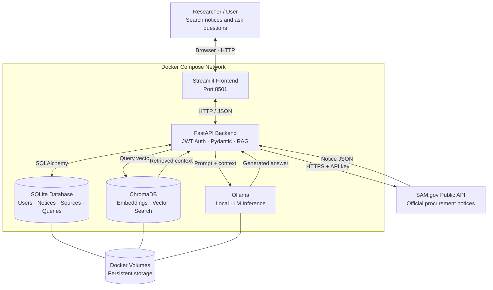

# Sentinel Scout

AI-powered federal procurement intelligence assistant using retrieval-augmented generation (RAG).

## System Architecture

The diagram below shows the application's services, communication paths, and data storage.

